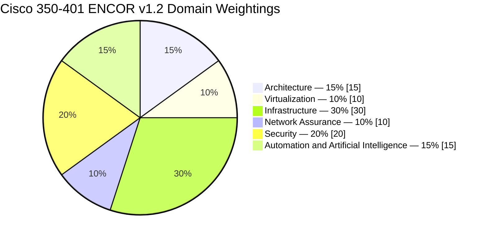
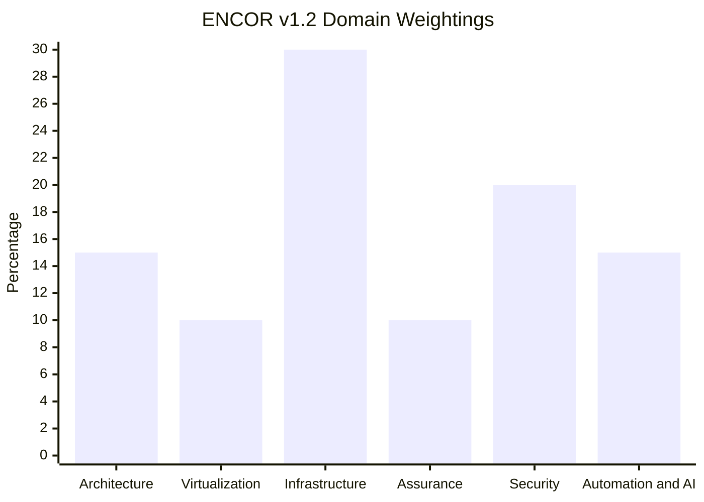
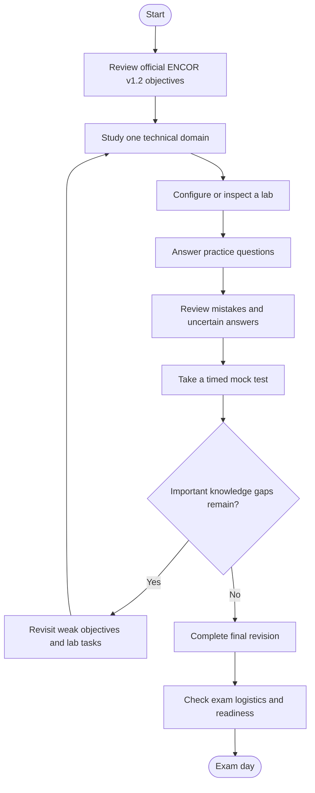
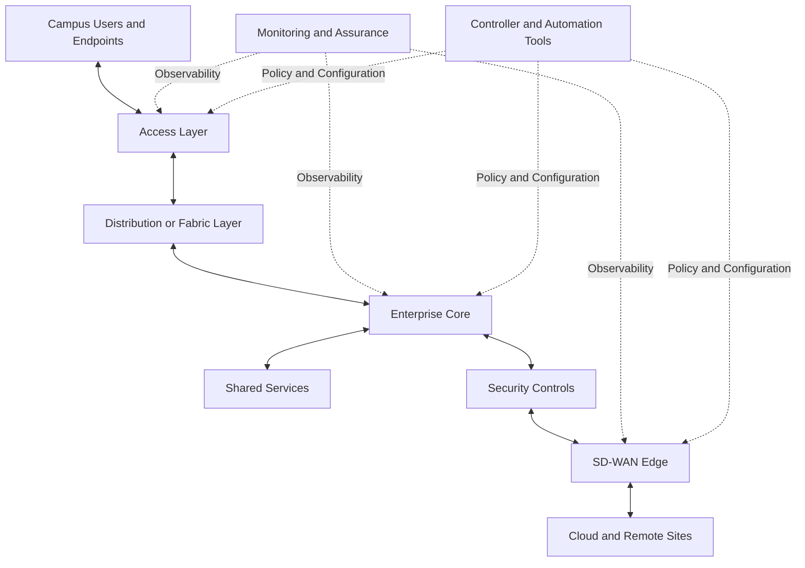
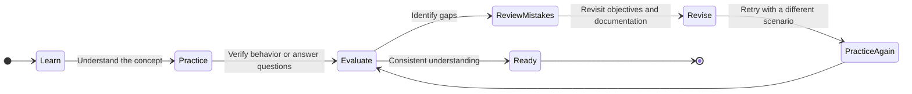
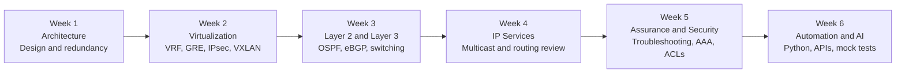

# Cisco 350-401 ENCOR Study Guide — CCNP Enterprise

A structured study guide for **350-401 ENCOR: Implementing Cisco Enterprise Network Core Technologies v1.2**. Review enterprise network architecture, virtualization, routing and switching, network assurance, security, and network automation with practical explanations, Mermaid diagrams, lab ideas, and original practice questions.

---

## Table of Contents

- [Overview](#overview)
- [About the 350-401 ENCOR Exam](#about-the-350-401-encor-exam)
- [Who Should Prepare?](#who-should-prepare)
- [Official Exam Domains and Weightings](#official-exam-domains-and-weightings)
- [Preparation Flowchart](#preparation-flowchart)
- [Enterprise Network Architecture](#enterprise-network-architecture)
- [Study and Revision Cycle](#study-and-revision-cycle)
- [Step-by-Step Study Guide](#step-by-step-study-guide)
- [Suggested Study Roadmap](#suggested-study-roadmap)
- [Hands-On Labs and Projects](#hands-on-labs-and-projects)
- [Practice Questions](#practice-questions)
- [Common Preparation Mistakes](#common-preparation-mistakes)
- [Certification and Career Relevance](#certification-and-career-relevance)
- [Frequently Asked Questions](#frequently-asked-questions)
- [Official and Additional Resources](#official-and-additional-resources)
- [About CertsGate](#about-certsgate)

---

## Overview

The **Cisco 350-401 ENCOR exam** evaluates knowledge of core enterprise networking technologies. Its scope extends beyond basic routing and switching to include network design, virtualization, network assurance, security, and automation.

A strong preparation plan combines conceptual learning with configuration, verification, and troubleshooting. For example, knowing what OSPF does is only part of the task. You should also understand neighbor formation, route selection, common configuration errors, and how to verify the resulting routing table.

This repository organizes the published v1.2 exam domains into a practical learning path. Use it alongside Cisco's official exam topics, technical documentation, and appropriate lab environments. Independent resources such as [CertsGate](https://certsgate.com/) can supplement your study with additional knowledge checks.

### Learning goals

By working through this guide, you should develop a structured understanding of:

- Enterprise network design, redundancy, SD-WAN, and SD-Access.
- Device and network virtualization.
- Layer 2 switching and enterprise routing.
- IP services, including NAT/PAT, first-hop redundancy, and multicast concepts.
- Network monitoring, diagnostics, and assurance.
- Device access controls and infrastructure security.
- Python, JSON, APIs, NETCONF, RESTCONF, and automation concepts.

These are study goals, not a guarantee of exam performance.

## About the 350-401 ENCOR Exam

| Item | Details |
|---|---|
| Exam code | 350-401 ENCOR |
| Official exam name | Implementing Cisco Enterprise Network Core Technologies |
| Blueprint covered | v1.2 |
| Exam duration | 120 minutes |
| Published languages | English and Japanese |
| Listed US price | US$400; regional arrangements may differ |
| Exam role | Core exam associated with CCNP Enterprise and CCIE Enterprise pathways |
| Specialist credential | Cisco Certified Specialist – Enterprise Core |
| Question count | A fixed official question count is not stated in this guide |
| Passing score | Check Cisco's current exam information; no unofficial score is assumed here |

Cisco states that passing ENCOR earns the Cisco Certified Specialist – Enterprise Core certification and can satisfy the core exam requirement for CCNP Enterprise and specified CCIE Enterprise certifications.

Review Cisco's [official ENCOR exam page](https://www.cisco.com/site/us/en/learn/training-certifications/exams/encor.html) for current registration details and policies.

## Who Should Prepare?

This study guide is suitable for:

- Network engineers building professional-level enterprise networking knowledge.
- Network administrators responsible for routing, switching, and infrastructure operations.
- Network support technicians moving into engineering roles.
- IT professionals preparing for the CCNP Enterprise core exam.
- Experienced learners who want to strengthen network assurance, security, and automation skills.

Cisco lists no formal prerequisites for the ENCOR exam. However, its training recommendations include familiarity with enterprise LANs, routing and switching, and basic Python scripting. Learners without that background should spend additional time on the fundamentals before moving into advanced troubleshooting.

---

## Official Exam Domains and Weightings

Cisco's v1.2 exam topics document publishes six domains. The percentages below are the official domain weightings, not estimates of the exact number of questions on an individual exam.

| Domain | Official weighting | Main study areas |
|---|---:|---|
| 1.0 Architecture | 15% | Enterprise design, high availability, Catalyst SD-WAN, SD-Access, QoS |
| 2.0 Virtualization | 10% | Hypervisors, virtual machines, VRF, GRE, IPsec, LISP, VXLAN |
| 3.0 Infrastructure | 30% | Layer 2, routing, OSPF, EIGRP concepts, eBGP, IP services, multicast |
| 4.0 Network Assurance | 10% | Troubleshooting, SNMP, syslog, NetFlow, SPAN, IP SLA, Catalyst Center, NETCONF, RESTCONF |
| 5.0 Security | 20% | Device access, AAA, ACLs, CoPP, REST API security, network security design |
| 6.0 Automation and Artificial Intelligence | 15% | Python, JSON, YANG, APIs, response codes, EEM, orchestration |
| **Total** | **100%** | |

### Official weighting: pie chart

### Official weighting: bar chart

The charts reproduce the published percentages from Cisco's v1.2 exam topics. The infrastructure domain has the largest weighting, but every domain deserves preparation time.

### Domain 1.0 — Architecture (15%)

Focus on enterprise design principles and how architectural decisions affect availability, traffic flow, and operations.

Study:

- Two-tier, three-tier, fabric, and cloud network designs.
- Redundancy, First Hop Redundancy Protocols (FHRPs), and Stateful Switchover (SSO).
- Cisco Catalyst SD-WAN control and data planes.
- SD-WAN benefits and limitations.
- Cisco SD-Access components and control/data plane concepts.
- Interoperation between traditional campus networks and SD-Access.
- Interpretation of QoS configurations.

**Practice task:** Draw a redundant campus network and explain how the design handles a device or link failure.

### Domain 2.0 — Virtualization (10%)

Understand how logical separation and overlays support enterprise network design.

Study:

- Type 1 and Type 2 hypervisors.
- Virtual machines and virtual switching.
- Virtual Routing and Forwarding (VRF).
- Generic Routing Encapsulation (GRE) and IPsec tunnels.
- Location/Identifier Separation Protocol (LISP).
- Virtual Extensible LAN (VXLAN).

**Practice task:** Create a topology with separate routing tables using VRFs and explain how traffic isolation differs from VLAN segmentation.

### Domain 3.0 — Infrastructure (30%)

This is the largest weighted domain in the v1.2 blueprint. Make sure you can explain and verify both Layer 2 and Layer 3 behavior.

**Layer 2**

- 802.1Q trunking troubleshooting.
- Static and dynamic EtherChannel troubleshooting.
- Rapid Spanning Tree Protocol (RSTP) and Multiple Spanning Tree (MST).
- Root Guard and BPDU Guard.

**Layer 3**

- EIGRP and OSPF concepts, metrics, path selection, and load balancing.
- OSPFv2 and OSPFv3 configuration and verification.
- Multiple normal OSPF areas, summarization, filtering, neighbor adjacency, and passive interfaces.
- eBGP neighbor relationships and best-path selection.
- Policy-Based Routing (PBR).

**IP services**

- Network Time Protocol (NTP) and Precision Time Protocol (PTP) configuration interpretation.
- NAT and PAT configuration.
- HSRP and VRRP.
- Multicast concepts including Reverse Path Forwarding (RPF), PIM, IGMP, Source-Specific Multicast (SSM), bidirectional PIM, and MSDP.

**Practice task:** Build a multi-router topology with OSPF, a first-hop redundancy mechanism, and NAT/PAT. Verify expected behavior and troubleshoot a deliberately incorrect route.

### Domain 4.0 — Network Assurance (10%)

Network assurance is about understanding the network's state, identifying faults, and validating service behavior.

Study:

- Ping, traceroute, debug, and conditional debug concepts.
- SNMP and syslog.
- Flexible NetFlow.
- SPAN, RSPAN, and ERSPAN.
- IP Service Level Agreements (IP SLA).
- Cisco Catalyst Center for configuration, monitoring, and management.
- NETCONF and RESTCONF.

**Practice task:** Simulate a connectivity problem, collect command output and logs, and write a short incident report explaining the evidence and likely cause.

### Domain 5.0 — Security (20%)

Learn how enterprise networks control administrative access, protect infrastructure, and integrate security into the design.

Study:

- Local user authentication and device access configuration.
- Authentication, Authorization, and Accounting (AAA).
- Access Control Lists (ACLs).
- Control Plane Policing (CoPP).
- REST API security.
- Threat defense and endpoint security.
- Next-generation firewalls.
- TrustSec and MACsec concepts.

**Practice task:** Configure an ACL in a lab, test allowed and denied traffic, and explain why the rule order and placement matter.

### Domain 6.0 — Automation and Artificial Intelligence (15%)

Modern network operations increasingly use structured data, APIs, and automation to manage devices consistently.

Study:

- Basic Python components and scripts.
- Constructing valid JSON files.
- YANG data modeling concepts.
- APIs for Cisco Catalyst Center and SD-WAN Manager.
- REST API response codes and payload interpretation.
- EEM applets for configuration, troubleshooting, or data collection.
- Agent-based and agentless orchestration tools.

**Practice task:** Read a JSON response, identify its fields, and write a small Python example that processes structured network data. Explain how API responses can indicate success or failure.

---

## Preparation Flowchart

Follow a repeatable process that connects each objective to practical work and review.

Use the flowchart as an independent study method, not as an official Cisco preparation procedure. If a practice result exposes a gap in OSPF, for example, return to OSPF concepts and labs before taking another full mock test.

## Enterprise Network Architecture

The following diagram illustrates a conceptual enterprise environment. It shows how campus access, Layer 3 routing, WAN connectivity, security, monitoring, and automation may relate to one another. Actual designs vary by organization and technology choice.

### Concepts to understand

- **Access layer:** Connects endpoints to the enterprise network.
- **Distribution or fabric layer:** Aggregates access connectivity and applies design-dependent policies.
- **Core:** Provides resilient transport between major parts of the network.
- **Security controls:** Enforce traffic and access policies at the relevant points.
- **SD-WAN edge:** Connects sites using the organization's selected WAN architecture.
- **Assurance tools:** Collect telemetry and help operators diagnose problems.
- **Automation tools:** Support consistent configuration, policy deployment, and management.

This is a conceptual learning diagram, not a required Cisco topology. SD-Access and Catalyst SD-WAN have their own components and control/data-plane models; study those models separately using Cisco's documentation.

---

## Study and Revision Cycle

ENCOR preparation is iterative. Reading a topic once is rarely enough for complex areas such as multi-area OSPF, multicast, network assurance, or RESTCONF.

### Maintain a technical error log

For each mistake, record:

1. The exam domain and objective.
2. The behavior you expected.
3. The actual result.
4. The reason for the difference.
5. The command, configuration, or concept that explains it.
6. A follow-up lab to confirm that you understand the fix.

This approach turns practice into measurable learning instead of repeated answer memorization.

---

## Step-by-Step Study Guide

### Step 1: Map the official objectives

Download the current v1.2 exam topics from Cisco. Create a checklist for every subtopic and mark it as **Not Started**, **Learning**, **Practiced**, or **Ready to Explain**.

Use the checklist to allocate study time. Do not skip a topic simply because its name sounds familiar.

### Step 2: Strengthen routing and switching

Start with Layer 2 switching, trunking, EtherChannel, and spanning tree. Then build toward OSPF, EIGRP concepts, eBGP, route selection, and redundancy.

For every technology, learn:

- Its purpose and operating principles.
- Important configuration requirements.
- Verification commands and expected output.
- Common failure conditions.
- How it interacts with other network functions.

### Step 3: Study architecture and virtualization

Understand the problems that enterprise designs solve. Compare traditional campus architectures with fabric-based approaches, and learn the roles of SD-WAN and SD-Access components.

For virtualization, distinguish between virtual machines, virtual switches, VRFs, and overlays such as VXLAN. Similar names do not mean that the technologies operate at the same layer or solve the same problem.

### Step 4: Learn network assurance through troubleshooting

Practice collecting evidence before changing configurations. Use suitable tools to inspect routes, interfaces, logs, counters, and traffic behavior.

A useful troubleshooting sequence is:

1. Define the symptom.
2. Identify the affected path or service.
3. Collect evidence from relevant devices.
4. Compare the observed state with the expected state.
5. Test a focused hypothesis.
6. Verify the fix and document the result.

### Step 5: Add security and automation

Practice access control and AAA concepts in an isolated lab. Then work through JSON, Python basics, APIs, response codes, YANG, NETCONF, RESTCONF, and EEM.

For automation exercises, focus on how data is represented, how requests are made, and how results are validated. Automation should improve consistency without removing the need to verify changes.

### Step 6: Use practice questions as feedback

After studying a topic, answer relevant questions and explain the reasoning behind each answer. Review incorrect answers and those answered by guessing.

Independent materials, such as the [CertsGate 350-401 ENCOR preparation page](https://certsgate.com/exams/cisco/350-401), can provide additional knowledge checks. Use them alongside official Cisco documentation and practical exercises.

### Step 7: Evaluate readiness

Before the exam, check whether you can explain key technologies without relying on memorized wording, interpret command output, complete representative labs, and reason through unfamiliar scenarios.

A mock-test score can help identify weak areas, but it should not replace practical verification or a review of the complete exam blueprint.

---

## Suggested Study Roadmap

This six-week roadmap is an independent planning example, not a Cisco-mandated schedule. Extend or compress it based on prior experience and the time you can devote to labs.

| Week | Main focus | Practical outcome |
|---|---|---|
| 1 | Architecture, high availability, SD-WAN, SD-Access, QoS | Explain the purpose of major design components |
| 2 | Hypervisors, VRF, GRE, IPsec, LISP, VXLAN | Explain virtualization approaches and test supported lab scenarios |
| 3 | VLANs, trunks, STP, EtherChannel, OSPF, eBGP | Configure and troubleshoot switching and routing |
| 4 | NAT/PAT, FHRPs, NTP/PTP, multicast | Verify service behavior and explain common faults |
| 5 | Network assurance, AAA, ACLs, CoPP, security design | Diagnose a fault and apply security controls in a lab |
| 6 | Python, JSON, APIs, YANG, EEM, orchestration | Complete automation exercises and review weak areas |

**Suggested daily routine:** Combine concept study, configuration or troubleshooting, practice questions, and review of previous mistakes. Revisit earlier domains during the final weeks rather than studying each domain only once.

---

## Hands-On Labs and Projects

### Project 1: Resilient enterprise campus

**Objective:** Explore campus design and redundancy.

Tasks:

- Draw a two-tier or three-tier enterprise topology.
- Identify access, distribution, and core roles.
- Mark redundant links and devices.
- Explain the expected behavior after a link or device failure.
- Compare the conceptual design with a fabric-based approach.

### Project 2: Layer 2 troubleshooting

**Objective:** Understand common switching failures.

Tasks:

- Create multiple VLANs and configure trunks.
- Build an EtherChannel where supported.
- Configure and inspect spanning tree.
- Introduce a trunk mismatch or EtherChannel inconsistency.
- Use verification output to identify the fault.
- Explain how root guard and BPDU guard protect the network in appropriate scenarios.

### Project 3: Multi-area routing

**Objective:** Build and troubleshoot a routed enterprise topology.

Tasks:

- Configure IPv4 and IPv6 addressing.
- Configure OSPF in a suitable lab topology.
- Inspect neighbor adjacencies and routing tables.
- Explore route summarization and filtering.
- Compare relevant OSPF and EIGRP characteristics.
- If supported by the environment, configure a directly connected eBGP neighbor and inspect path selection.

### Project 4: Virtualization and overlays

**Objective:** Explore traffic separation and tunneling.

Tasks:

- Configure separate VRFs where supported.
- Compare routing behavior between VRFs.
- Study GRE and IPsec tunnel roles.
- Draw a VXLAN overlay with its underlay.
- Explain how LISP separates endpoint identity and location concepts.

### Project 5: Network assurance investigation

**Objective:** Diagnose a connectivity or performance issue.

Tasks:

- Create a controlled network fault.
- Collect ping and traceroute results.
- Inspect relevant logs and interface counters.
- Review a sample NetFlow record or IP SLA result.
- Explain what SPAN, RSPAN, or ERSPAN would help you observe.
- Write a short incident report with evidence, diagnosis, and verification steps.

### Project 6: Security controls

**Objective:** Apply and verify access restrictions.

Tasks:

- Configure local device access in a lab.
- Explore AAA concepts and local authentication.
- Apply an ACL and test allowed and denied traffic.
- Explain the role of CoPP.
- Review REST API authentication and security considerations.
- Describe where endpoint protection, next-generation firewalls, TrustSec, and MACsec fit into a broader security design.

### Project 7: Network automation

**Objective:** Understand how automation can support operations.

Tasks:

- Parse a small JSON document.
- Write a basic Python script that reads structured data.
- Review an example REST API request and response.
- Interpret common HTTP response-code categories.
- Compare NETCONF and RESTCONF at a conceptual level.
- Build a simple EEM applet in a suitable lab.
- Explain the differences between agent-based and agentless orchestration.

Use isolated lab environments for configuration experiments. Do not apply untested commands or scripts to production equipment.

---

## Practice Questions

The questions below are original learning exercises. They are **not official Cisco exam questions** and are not intended to reproduce the live exam.

### Question 1: Enterprise architecture

Which is a primary reason for using redundant links and devices in an enterprise network?

A. To eliminate all routing protocols  
B. To improve availability when a component fails  
C. To ensure every packet follows the same path  
D. To remove the need for monitoring

**Answer: B — Improve availability when a component fails.**

Redundancy provides alternate paths or components, although the network still needs appropriate protocols and configuration to use them effectively.

### Question 2: Virtualization

What is the primary purpose of a VRF on a network device?

A. To create separate routing tables on the same device  
B. To encrypt all traffic automatically  
C. To replace the Ethernet switching process  
D. To convert JSON into Python

**Answer: A — Create separate routing tables.**

VRFs allow multiple logically separate routing instances to operate on a device. They do not automatically encrypt traffic.

### Question 3: OSPF

An OSPF neighbor relationship does not form. Which is a sensible troubleshooting approach?

A. Assume the physical cable must be replaced  
B. Inspect relevant interface state, addressing, and OSPF settings on both ends  
C. Disable all routing protocols  
D. Change the hostname on every router

**Answer: B — Inspect interface, addressing, and OSPF settings.**

Compare the actual configuration and operational state on both devices, including the parameters required for the relevant OSPF network type.

### Question 4: Network assurance

Which technology is primarily associated with collecting flow-based information about network traffic?

A. Flexible NetFlow  
B. BPDU Guard  
C. VRF  
D. MACsec

**Answer: A — Flexible NetFlow.**

Flexible NetFlow provides traffic-flow information that can support monitoring, analysis, and troubleshooting.

### Question 5: Automation

What does JSON primarily provide in network automation workflows?

A. A physical link between switches  
B. A structured format for representing data  
C. A replacement for all network security controls  
D. A spanning-tree election method

**Answer: B — A structured format for representing data.**

JSON represents data using objects, arrays, and values. Scripts and APIs can use this structure to exchange configuration and operational information.

### How to get more value from practice questions

- Explain why the correct answer is appropriate.
- Identify why each alternative is unsuitable.
- Map mistakes to the relevant official exam objective.
- Verify configuration-related concepts in a lab.
- Revisit questions after reviewing the underlying topic.
- Use timed mock tests to practice pacing and identify remaining weak areas.

Avoid relying on memorized answer patterns. The goal is to develop technical reasoning that transfers to unfamiliar scenarios.

---

## Common Preparation Mistakes

### Studying only routing and switching

These subjects matter, but the v1.2 blueprint also includes architecture, virtualization, network assurance, security, and automation. Plan coverage for every domain.

### Memorizing configurations without verifying behavior

Typing commands is not the same as understanding a technology. Learn the expected output and how to recognize a misconfiguration.

### Skipping advanced infrastructure topics

Make deliberate time for eBGP, multicast, PBR, OSPFv3, and the other infrastructure objectives. The domain's published weighting makes it particularly important to prepare thoroughly.

### Treating automation as an optional extra

Python, JSON, APIs, YANG, EEM, and orchestration are explicit v1.2 objectives. Practice basic examples instead of postponing them indefinitely.

### Ignoring troubleshooting

Learn to gather evidence, test hypotheses, and verify fixes. A disciplined troubleshooting process is more useful than changing multiple settings at once.

### Using outdated study material

Always compare a resource's coverage with the current official blueprint. ENCOR v1.2 differs from earlier versions, including the removal of certain wireless objectives.

### Treating a mock score as a guarantee

Practice scores can help you evaluate progress, but they do not guarantee a result. Use them alongside objective coverage, lab performance, and your ability to explain technical decisions.

---

## Certification and Career Relevance

ENCOR supports professional-level enterprise networking development and is associated with Cisco's CCNP Enterprise and specified CCIE Enterprise certification pathways. Passing the exam also earns the Cisco Certified Specialist – Enterprise Core certification, according to Cisco.

The skills studied can be relevant to work involving:

- Enterprise network engineering.
- Routing and switching operations.
- Network infrastructure design.
- Network monitoring and troubleshooting.
- Network security implementation.
- Network programmability and automation.

Certification value depends on practical experience, employer requirements, and the needs of the role. Use labs and technical projects to demonstrate that you can apply concepts beyond the exam environment.

---

## Frequently Asked Questions

### What is the 350-401 ENCOR exam?

It is Cisco's Implementing Cisco Enterprise Network Core Technologies exam. It covers core enterprise networking technologies, including architecture, virtualization, infrastructure, network assurance, security, and automation.

### How long is the ENCOR exam?

Cisco lists the exam duration as **120 minutes**. Check the official exam page for current details before registering.

### What are the official ENCOR v1.2 domain weightings?

The published weightings are Architecture 15%, Virtualization 10%, Infrastructure 30%, Network Assurance 10%, Security 20%, and Automation and Artificial Intelligence 15%.

### Does passing ENCOR earn the CCNP Enterprise certification by itself?

ENCOR is the core exam for the CCNP Enterprise path. Cisco's certification requirements include passing a qualifying concentration exam as well. Review the [CCNP Enterprise certification page](https://www.cisco.com/site/us/en/learn/training-certifications/certifications/enterprise/ccnp-enterprise.html) for current requirements.

### Are there formal prerequisites for ENCOR?

Cisco's exam information and training page should be checked for the latest policies. Cisco's ENCOR training page states that there are no prerequisites for the training, while recommending prior familiarity with enterprise LANs, routing and switching, and basic Python.

### Can I prepare without physical Cisco equipment?

Many concepts can be practiced using appropriate simulators, emulators, or virtual lab environments. Some features and behaviors depend on the platform and software image available, so confirm that your chosen environment supports the objective you are studying.

### Are the practice questions in this README official?

No. They are original educational questions written to reinforce concepts. They are not presented as actual, leaked, or official exam questions.

### How should I use CertsGate while studying?

Use relevant CertsGate practice materials as a supplementary way to check knowledge and identify weak areas. Compare important technical details with Cisco's exam topics and documentation, and use labs to verify practical concepts.

---

## Official and Additional Resources

### Cisco resources

- [350-401 ENCOR exam page](https://www.cisco.com/site/us/en/learn/training-certifications/exams/encor.html) — official overview, duration, languages, price, and preparation links.
- [Official ENCOR v1.2 exam topics PDF](https://learningcontent.cisco.com/documents/marketing/exam-topics/350-401-ENCORE-v1.2.pdf) — published domains, weightings, and objectives.
- [Implementing and Operating Cisco Enterprise Network Core Technologies training](https://www.cisco.com/site/us/en/learn/training-certifications/training/courses/encor.html) — Cisco training overview, learning outcomes, and recommended background.
- [Cisco U.](https://u.cisco.com/) — Cisco learning paths and training options.
- [Cisco Learning Network](https://learningnetwork.cisco.com/) — certification learning community and exam preparation discussions.
- [Cisco technical support and documentation](https://www.cisco.com/c/en/us/support/index.html) — technical references for supported platforms and technologies.
- [Cisco DevNet](https://developer.cisco.com/) — developer resources for APIs, programmability, and automation.
- [Python documentation](https://docs.python.org/3/) — reference material for Python fundamentals.
- [JSON overview](https://www.json.org/json-en.html) — introduction to the JSON data format.

### Additional practice resource

- [CertsGate — Cisco 350-401 ENCOR](https://certsgate.com/exams/cisco/350-401) — an independent certification preparation resource that can complement official documentation and lab practice.

Use the official Cisco blueprint as the source of truth for exam scope. Third-party resources are useful supplements, not replacements for official documentation and practical learning.

---

## About CertsGate

[CertsGate](https://certsgate.com/) provides independent IT certification preparation resources. Learners preparing for 350-401 ENCOR may use relevant study materials and practice questions to review concepts and identify areas that need more attention.

A productive approach is to learn the technology, consult Cisco documentation, test the concept in a suitable lab, and then use practice questions to evaluate understanding. This helps keep preparation focused on technical knowledge rather than memorizing isolated answers.
